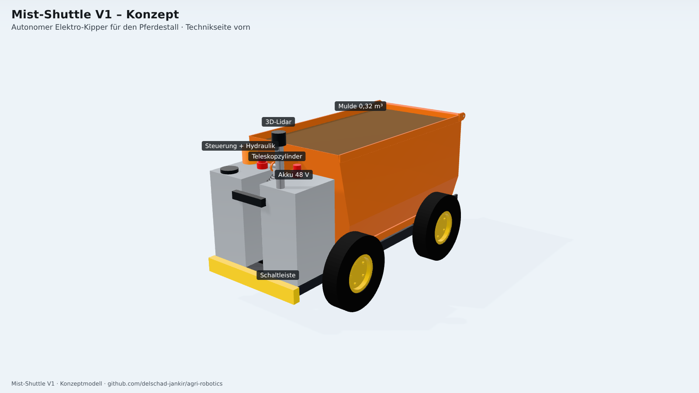
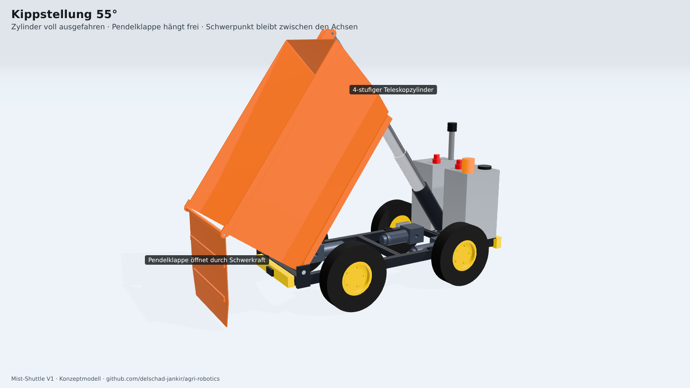
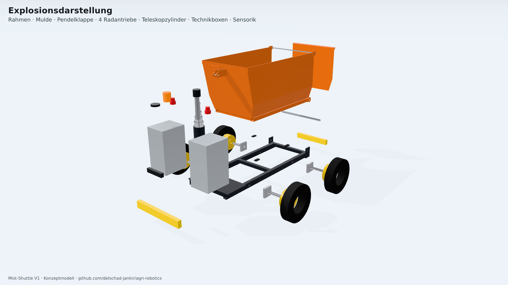

# agri-robotics

Robotik für landwirtschaftliche Betriebe. Ausgangspunkt ist ein Gespräch mit einem Pferdebetrieb: Mist wird von Hand geladen, in Containern durch die Stallgasse geschoben und mit dem Teleskoplader zum Mistplatz gefahren.

**Mist-Shuttle V1 (Konzept):** ein autonomer Elektro-Kipper. Er wird an der Box von Hand beladen, fährt selbst zum Mistplatz, kippt ab und kommt zurück.

| | |
|---|---|
|  |  |

**Animationen:** [Kippvorgang](docs/img/anim_kippen.mp4) · [Rundumansicht](docs/img/anim_rundum.mp4) · [Explosion](docs/img/anim_explosion.mp4) · [Einsatzszenario](docs/img/anim_einsatz.mp4)

## Dokumente

1. [Gespräch (anonymisiert)](docs/01_gespraech.md)
2. [Lastenheft](docs/02_lastenheft.md)
3. [Konzept, Prüfergebnisse, Auslegung](docs/03_konzept.md)
4. [Kostenschätzung](docs/04_kosten.md)

## CAD

- Parametrisches Modell in Python ([build123d](https://github.com/gumyr/build123d), OpenCascade-Kern): [`cad/model.py`](cad/model.py)
- Automatische Konstruktionsprüfung (Kollisionen über den ganzen Kippweg, freischwebende Teile, Verbindungen, Standsicherheit, Zylinderkraft): [`cad/check.py`](cad/check.py)
- STEP-Baugruppe für Fusion 360 und andere CAD-Systeme: [`out/mist_shuttle_v1.step`](out/mist_shuttle_v1.step)

Wie man das Modell neu erzeugt und rendert, steht in der [`AGENTS.md`](AGENTS.md).
