# Konzept – Mist-Shuttle V1

Stand 30.10.2026 · Konzeptphase · CAD: [`cad/model.py`](../cad/model.py) · STEP: [`out/mist_shuttle_v1.step`](../out/mist_shuttle_v1.step)

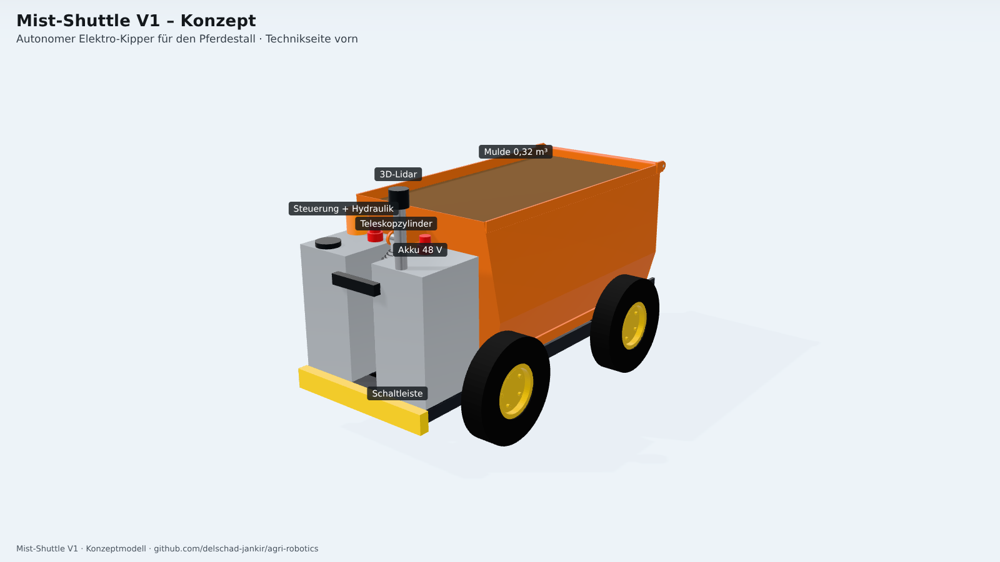

## 1. Kurzbeschreibung

Elektrisches 4-Rad-Fahrzeug (Skid-Steer) mit **Hinterkippmulde** (0,32 m³) und **Pendelklappe**. Die Mulde wird über einen **4-stufigen, einfachwirkenden Teleskopzylinder** gekippt und senkt sich durch ihr Eigengewicht ab. Vorn sitzt das **Technikmodul**: Akku, Steuerung, Hydraulikaggregat, 3D-Lidar und Not-Halt.

| Kennwert | Wert | Quelle |
|---|---|---|
| Abmessungen B × L × H | 790 × 1575 × 965 mm (bis Lidar) | CAD |
| Ladekante | 820 mm | CAD |
| Radstand / Spurweite | 800 / 700 mm, Reifen 4.00-8 (Ø 400) | CAD |
| Bodenfreiheit | 145 mm (Getriebe) | Prüfung |
| Muldenvolumen (gestrichen, 780 mm) | 0,323 m³ ≈ 242 kg bei 750 kg/m³ | CAD |
| Masse leer / beladen | 354 kg / 596 kg | CAD (Volumen × Dichte, Katalogwerte) |
| Kippwinkel | 55° (Anschlag), Zylinderhub reicht bis 56,0° | Kinematik |
| Zylinderkraft max. | 1,37 kN (beladen, θ = 0°) | virtuelle Arbeit |
| Antrieb | 4 × BLDC 48 V 750 W, Schneckengetriebe i ≈ 40, Haltebremse | Auslegung |
| Akku | LiFePO4 48 V 100 Ah (3,8 kWh nutzbar) ≈ 2,6 Arbeitstage | Auslegung |
| Wendekreis | dreht auf der Stelle, Hüllkreis Ø ≈ 1,7 m | CAD |

## 2. Lösungsvarianten und Entscheidung

Jede Teilfunktion wurde mit 2–4 Varianten betrachtet. Bewertet wurde nach Robustheit im Stall, Sicherheit, Kosten und Bauraum.

| Teilfunktion | Varianten | Gewählt | Begründung |
|---|---|---|---|
| Fahrwerk | Differential + Lenkrolle · **4WD Skid-Steer** · Raupe | 4WD Skid-Steer | Lenkrollen setzen sich mit Mist und Stroh zu. Raupen sind teuer und laut und beschädigen Gummimatten. Skid-Steer dreht auf der Stelle und hat 4 angetriebene Räder für Traktion auf Mist. |
| Radantrieb | Nabenmotor · Kette je Seite · **Getriebemotor je Rad** | Getriebemotor je Rad (Schnecke) | Keine offene Kette im Mist. Das Schneckengetriebe ist selbsthemmend und hält am Hang. Ein Ausfall eines Rads bleibt fahrbar. |
| Entleeren | Vorderkipper · **Hinterkipper mit Pendelklappe** · Schubschild · Hochkipper | Hinterkipper | Beim **Vorderkipper** wandert der Ladungsschwerpunkt beim Kippen vor die Vorderachse: Das Fahrzeug kippt nach vorn, wenn der Mist klebt (nachgerechnet, verworfen). Das Schubschild ist mechanisch aufwendig und klemmt bei Stroh. Den Hochkipper gibt es als Option für V2, falls in einen Container gekippt werden muss. |
| Kippantrieb | E-Linearantrieb · **Teleskop-Hydraulik** | Teleskopzylinder 4-stufig | Ein E-Linearantrieb unter der Mulde braucht entweder ~10 kN Kraft (kurzer Hebel) oder ~450 mm Hub bei ~500 mm Einbaulänge, und das passt nicht unter die 820 mm hohe Ladekante. Der Teleskopzylinder vorn hat einen langen Hebel (1,27 m): Er braucht nur 1,4 kN und ist ein robustes Kipper-Standardteil. |
| Navigation | Bodenmarker/Magnetband · **3D-Lidar-SLAM + Kamera** · RTK-GNSS | Lidar-SLAM innen, RTK-GNSS außen als Option | Ohne bauliche Änderung im Stall. Das Lidar übernimmt zugleich die Hinderniserkennung. |
| Energie | Blei-Gel · **LiFePO4 48 V** | LiFePO4 | Zyklenfest, leicht, 48 V bleibt Schutzkleinspannung. |

## 3. Aufbau

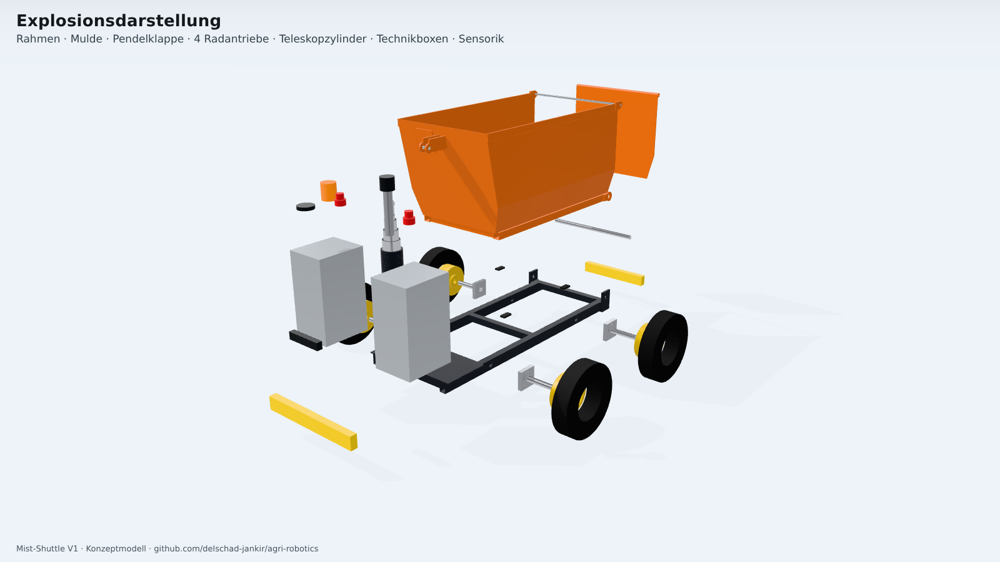

1. **Rahmen** (Schweißbaugruppe, S235, feuerverzinkt): 2 Längsträger 60×40×3, 4 Querträger 40×40×3, Kipplagerböcke, Technikboden 6 mm mit Ausschnitt für den Zylinder, Zylinder-Fußgabel.
2. **Mulde** (Schweißbaugruppe, 3 mm Seiten, 4 mm Boden): unten schmal (520 mm) zwischen den Rädern, ab 430 mm Höhe gerade Wände (610 mm). Dazu Unterrahmen 40×40, Kipplaschen, Scharnierohren und Kopfgabel mit Doppler an der Stirnwand. Die Mulde liegt auf 4 Gummipuffern auf.
3. **Pendelklappe** an der Rückseite. Sie hängt an einem Bolzen Ø12 und öffnet beim Kippen durch die Schwerkraft. Bei 55° hängt sie 24 mm über dem Boden (siehe offene Punkte).
4. **Radantrieb** ×4: Stummelwelle Ø30 im Flanschlager UCF206 außen und in der Hohlwelle des Schneckengetriebes innen. Der Motor liegt längs, das spart Bauraum zwischen den Trägern.
5. **Kippzylinder**: 4-stufiger Teleskopzylinder (Stufen Ø91/76/61/46), Einbaulänge 513 mm, Hub 1140 mm, einfachwirkend. Die Führungsüberdeckung jeder Stufe beträgt mindestens 63 mm. Zylinderfuß am vorderen Querträger, Kopf an der Stirnwand. Ein Bodenstück mit Konus gibt bei 55° Freigang zum Querträger.
6. **Technikmodul**: links der Akku, rechts Steuerung, Motorregler, Sicherheitssteuerung und 24-V-Kipperaggregat (über DC/DC). Der Zylinder läuft zwischen den beiden Boxen.
7. **Sensorik/Sicherheit**: 3D-Lidar (360°) auf dem Mast, Stereokamera vorn, Tiefenkamera hinten, Schaltleisten vorn und hinten, 2 Not-Halt-Taster, Rundumleuchte, RTK-GNSS-Antenne.

| Ansicht | |
|---|---|
| 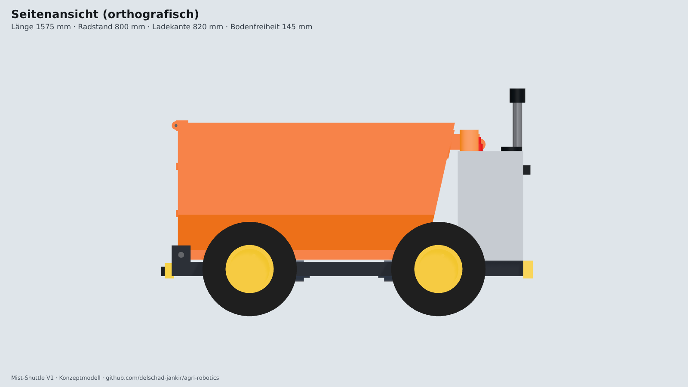 | 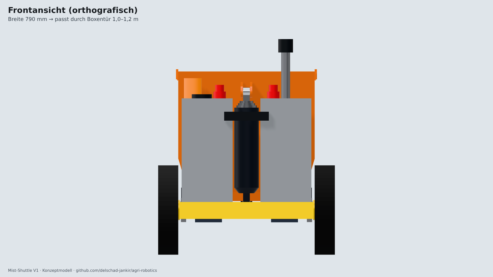 |
| 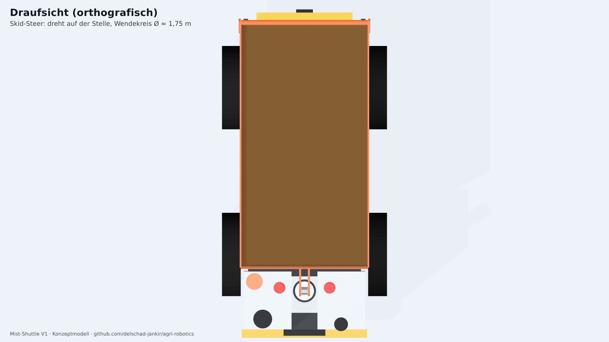 | 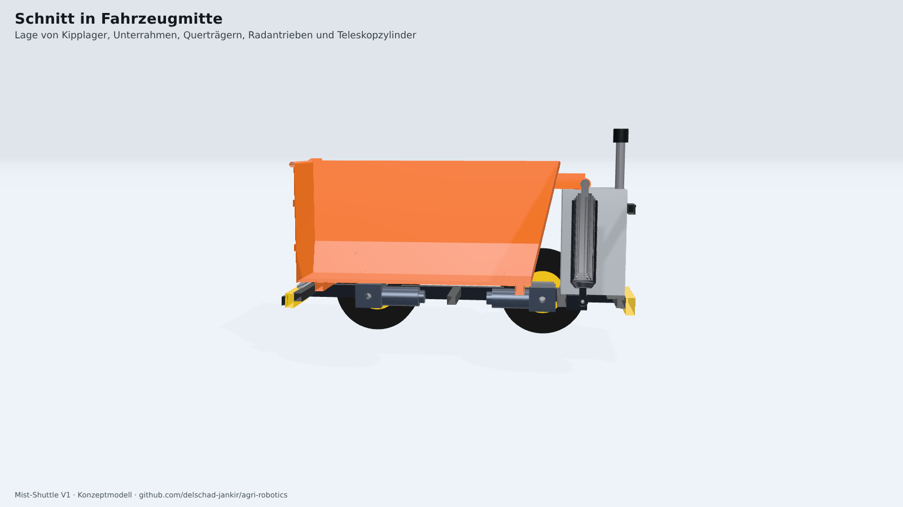 |
| 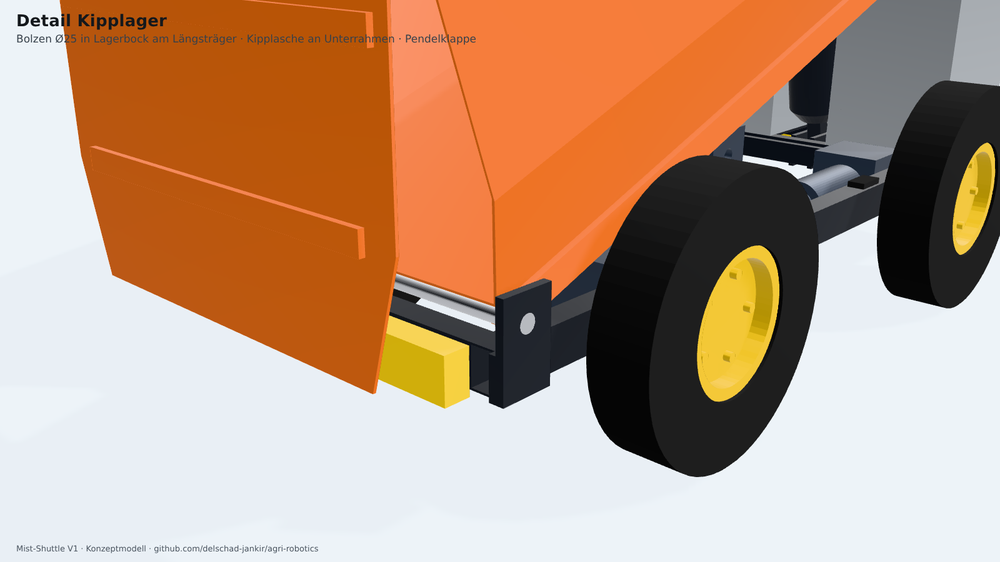 | 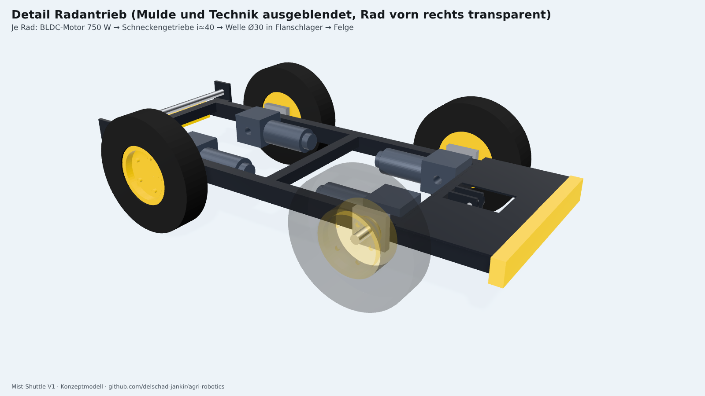 |
| 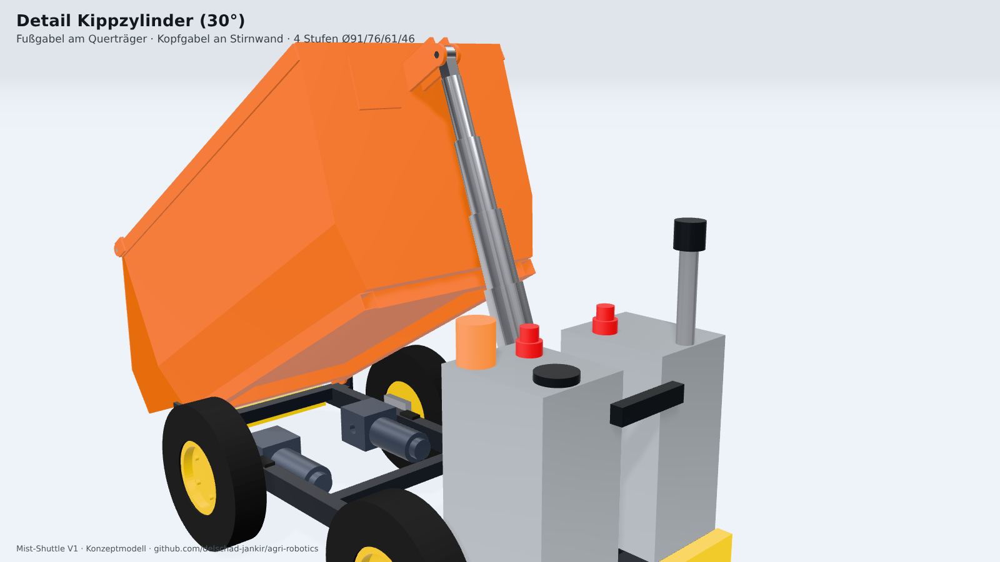 | 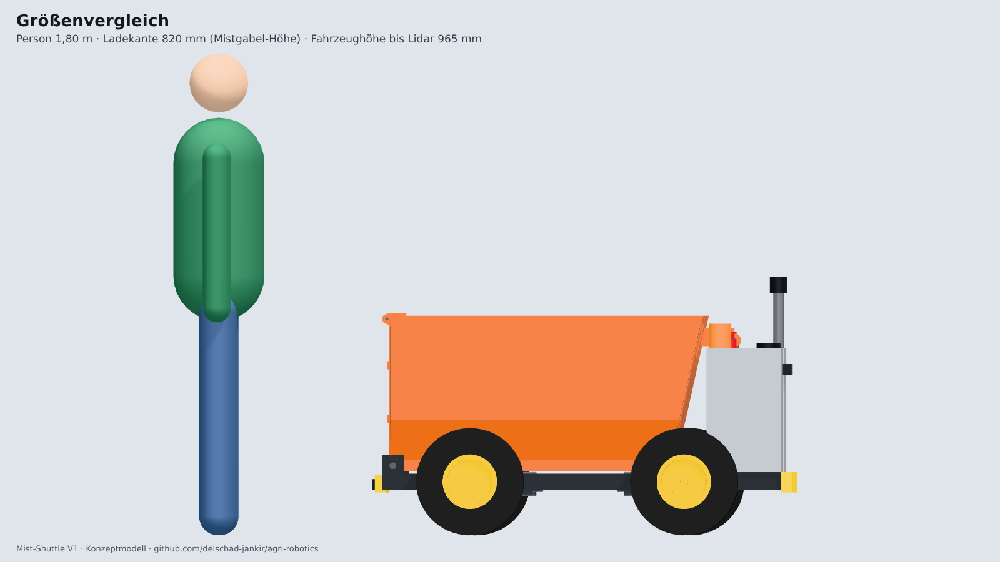 |

## 4. Konstruktionsprüfung (automatisch, [`cad/check.py`](../cad/check.py))

Jede Änderung am Modell durchläuft dieselbe Prüfung. Das Ergebnis steht in [`out/check_report.json`](../out/check_report.json).

| Prüfung | Methode | Ergebnis |
|---|---|---|
| Schweißbaugruppen zusammenhängend | Anzahl Volumenkörper je Baugruppe = 1 | ✅ alle 1 |
| Kollision in Ruhelage | Boolesche Schnittmenge aller 1.326 Teilepaare (52 Teile), Grenze 1 mm³ | ✅ 0 |
| Verbindungen haben Kontakt | 58 definierte Verbindungen (Bolzen, Lager, Verschraubung), Abstand ≤ 0,3 mm | ✅ 58/58 |
| Freischwebende Teile | Graph aller Verbindungen: jedes Teil erreicht den Rahmen | ✅ 0 |
| Bodenkontakt | alle 4 Reifen auf z = 0, Bodenfreiheit ≥ 120 mm | ✅ 145 mm |
| Kollision über den Kippweg | 0° bis 55° in 2,5°-Schritten; Mulde, Klappe, Bolzen und 5 Zylinderteile gegen alle Teile | ✅ 0 |
| Hub reicht | Zylinderlänge(θ) ≤ Einbaulänge + Hub | ✅ bis 56,0° |
| Führungsüberdeckung Teleskop | ≥ 50 mm je Stufe bei vollem Hub | ✅ 63 mm |
| Selbständiges Absenken | Moment der leeren Mulde um das Kipplager > 0 bei jedem Winkel | ✅ |
| Standsicherheit | statische Kippgrenze aus Schwerpunkt und Aufstandsfläche, beladen und leer, über den Kippweg | ✅ min. 16,2° (nach hinten, bei 55°) |

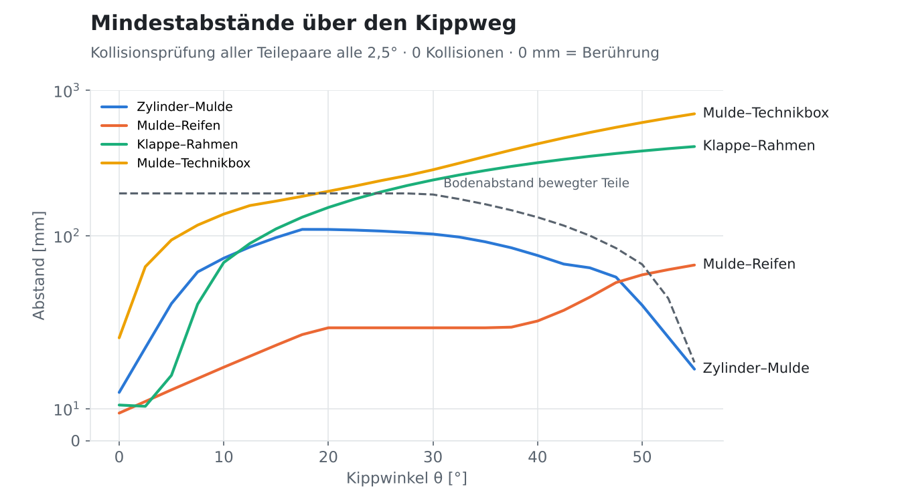

**Befunde aus der Design-Review**, die das Modell geändert haben (alle von der Prüfung gefunden, nicht von Hand):

1. Mit einem 3-stufigen Zylinder reichte der Hub nur bis **40°**. → 4-stufig, Fußpunkt 43 mm tiefer.
2. Ab 10° streifte das Zylinderrohr die Fußgabel auf dem Technikboden. → Gabel an den Querträger verlegt, Ausschnitt im Technikboden.
3. Die Zylinderstange drang zwischen 2,5° und 55° in die Kopfgabel ein. → Stange endet unterhalb der Gabel, Gabel schlanker, Zylinder 35 mm nach vorn.
4. Bei 55° berührte das Zylinderrohr den Querträger. → Bodenstück konisch, Kopfauge 20 mm höher.

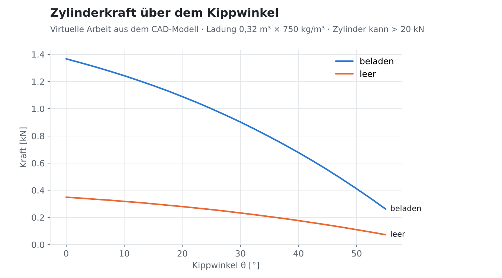
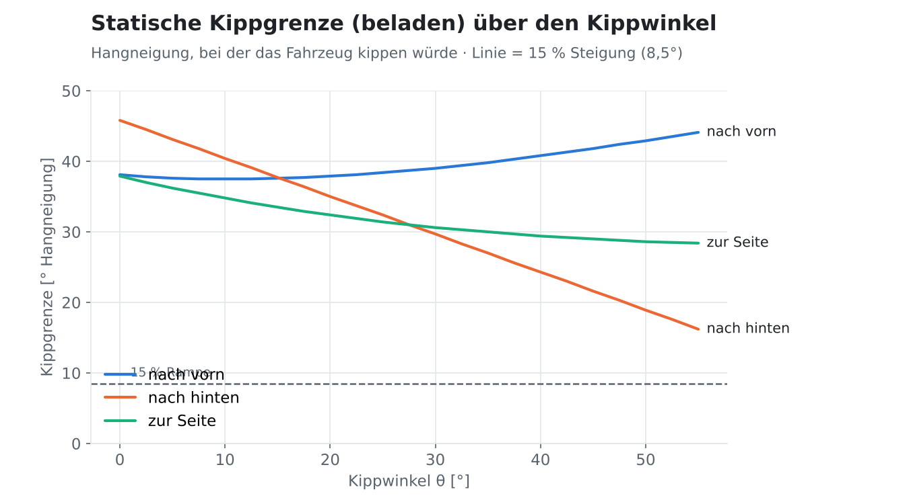
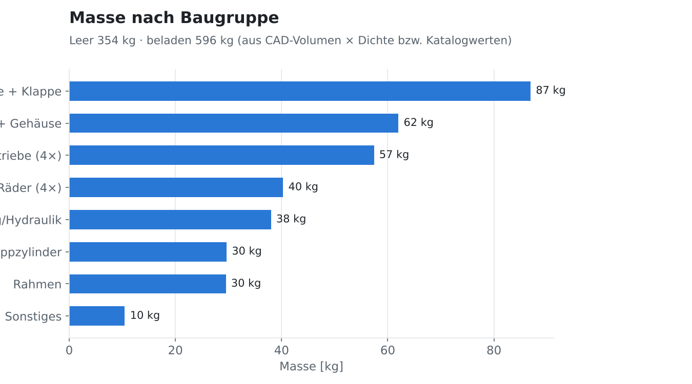

## 5. Auslegung Fahrantrieb und Energie ([`cad/calc.py`](../cad/calc.py))

| Größe | Wert |
|---|---|
| Zugkraft beladen, 15 % Steigung, Schotter, 0,5 m/s² | 1.744 N |
| Bohrmoment beim Drehen auf der Stelle (μ = 0,6) | 702 Nm → 1.003 N Umfangskraft je Seite |
| erforderliches Radmoment | 100 Nm je Rad |
| Raddrehzahl bei 1,2 m/s | 57 1/min (Motor 3000 1/min, i ≈ 40 → max. 1,57 m/s) |
| Leistung am Hang (0,6 m/s) | 1,6 kW gesamt → 4 × 750 W reichen mit Reserve |
| Energie pro Fahrt (2 × 120 m, Wenden, Kippen) | ≈ 31 Wh |
| Energie pro Tag (40 Fahrten + 4 h Rechner) | ≈ 1,5 kWh → Akku reicht für ≈ 2,6 Tage |

**Befund Traktion:** Auf einer mit Mist verschmierten Rampe (μ ≈ 0,3) sind nur ~1.735 N übertragbar, das ist knapp unter dem Bedarf von 1.744 N. Für V1 heißt das: Rampen ≤ 10–12 % oder sauber halten, sanft anfahren. Grobstollige AS-Reifen sind gesetzt. Optional kommen Ketten über die Räder für den Winter.

## 6. Offene Punkte und Risiken

| # | Punkt | Bewertung / nächster Schritt |
|---|---|---|
| R1 | **Verriegelung der Pendelklappe** ist noch nicht konstruiert. Beim Fahren drückt der Mist gegen die Klappe. | Zwangsgesteuerter Riegel über Zugstange vom Kippwinkel oder kleiner Linearaktor. Nächste Iteration. |
| R2 | Klappe hängt bei 55° nur 24 mm über dem Boden und streift den Haufen | Unkritisch, weil sie pendelt. Alternativ beim Kippen 0,3 m vorziehen (Software). |
| R3 | **Haufen wächst** hinter der Mistplatte nicht von allein; ein Lader muss ihn zusammenschieben | Beim Besuch klären. Option Hochkipper (V2) bzw. Kippen in einen Container. |
| R4 | Mist klebt bei Nässe bzw. Frost an der Mulde | PE-Auskleidung (W), Kippwinkel 55° plus kurzes Rütteln (Software) |
| R5 | Traktion auf verschmutzter Rampe (siehe 5.) | Rampe messen; ggf. Gewicht nach vorn, Ketten |
| R6 | Masse 354 kg (Mulde 73 kg, Akku 62 kg) | Mulde in 2 mm + Sicken oder Aluminium; Akku 50 Ah reicht für 1,3 Tage |
| R7 | Reaktion der **Pferde** auf das Fahrzeug | Beim Besuch testen (zunächst ferngesteuert, leise, langsam) |
| R8 | Sicherheitskonzept (PL d) für autonomes Kippen | Risikobeurteilung nach EN ISO 12100 vor dem ersten Test mit Tieren |

**Grenzen des Modells:** Das ist ein Konzeptmodell. Es enthält keine FEM-Festigkeitsrechnung. Normteile (Lager, Getriebe, Zylinder) sind vereinfacht als Hüllgeometrie modelliert. Schrauben, Schläuche und Kabel fehlen; Verbindungen werden als Kontaktflächen geprüft. Die Massen sind abgeschätzt. Vor der Fertigung folgen Detailkonstruktion, Festigkeitsnachweis (Rahmen, Kipplager, Bolzen) und reale Katalogteile.

## 7. In Fusion 360 öffnen

1. [`out/mist_shuttle_v1.step`](../out/mist_shuttle_v1.step) herunterladen.
2. In Fusion: **Datei → Öffnen → „Von meinem Computer öffnen“**, die STEP-Datei wählen. Es entsteht eine Baugruppe mit 52 benannten Komponenten (Einheiten: mm).
3. Gelenke anlegen: Kipplager (Drehgelenk um den Kippbolzen), Klappenbolzen, Zylinder-Fuß- und Kopfbolzen (Drehgelenke), Zylinderstufen (Schiebegelenke), 4 Radachsen (Drehgelenke). Danach lässt sich der Kippvorgang in Fusion bewegen.
4. Änderungen am Konzept erfolgen weiterhin im Python-Modell (Parameter oben in `cad/model.py`). Danach `check.py` und `export.py` ausführen und die STEP-Datei neu importieren.

## 8. Nächste Schritte

1. **Besuch vor Ort** mit Maßband, Fragen siehe [Lastenheft, Kapitel 8](02_lastenheft.md#8-offene-fragen-für-den-besuch-vor-ort). Danach die Annahmen (A) im Lastenheft ersetzen.
2. Konzept nachschärfen: Klappenverriegelung, Spritzschutz, Kotflügel, Ladebuchse, Zugöse für V2.
3. **Funktionsmuster ferngesteuert** (ohne Autonomie, Planwert ≈ 8 k€, wird später zu Prototyp 1 aufgerüstet) bauen und beim Betrieb testen: Akzeptanz, Pferde, Traktion, Kippen.
4. Parallel Modul V2 „Container-Schlepper“ skizzieren, sobald die Containermaße bekannt sind.
